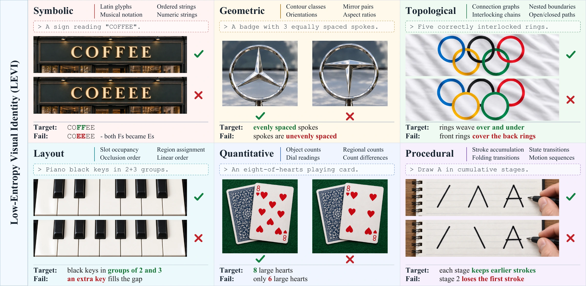
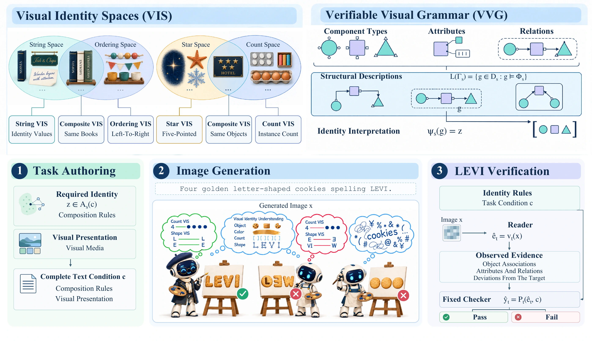

<h1 align="center">
  LEVI: Benchmarking Visual Identity Fidelity<br>
  with Verifiable Low-Entropy Constructs
</h1>

<p align="center">
  <a href="mailto:mx@molardata.com">Xiao Ma</a><sup>1</sup> &nbsp;·&nbsp;
  <a href="mailto:z.zhan@imperial.ac.uk">Zhonghao Zhan</a><sup>2</sup> &nbsp;·&nbsp;
  <a href="mailto:h.haddadi@imperial.ac.uk">Hamed Haddadi</a><sup>2</sup> &nbsp;·&nbsp;
  <a href="mailto:chenqi@molardata.com">Qi Chen</a><sup>1</sup>
  <br>
  <sup>1</sup> ZODA &nbsp;&nbsp; <sup>2</sup> Imperial College London
</p>

<p align="center">
  <a href="docs/assets/levi-paper.pdf"></a>
  <a href="benchmark/README.md"></a>
  <a href="https://github.com/maxiao0234/LEVI"></a>
  <a href="#results"></a>
</p>

<p align="center"><em>A precise failure inside plausible images.</em></p>

**LEVI** evaluates whether generated images preserve the compact facts and explicit rules that define visual identity, while allowing variation in appearance. A word can look like a convincing sign yet contain the wrong letters; a plausible object can have the wrong geometry, connections, arrangement, or count. LEVI makes these identity requirements explicit and evaluates them at the level of a complete task.

The benchmark contains **1,375 tasks**, spanning **120 base visual identity spaces (BVIS)** across **six domains**. Among ten evaluated model configurations, the highest whole-task pass rate is **58.69%**.

<p align="center">
  <a href="docs/assets/identity-overview.webp"></a>
  <br>
  <sub><strong>Figure 1.</strong> The six visual identity domains in LEVI. Conceptual illustrations from the paper.</sub>
</p>

## Method

**Visual Identity Spaces (VIS)** specify the admissible identity values and which different visual realizations express the same identity. This separates the facts that must be preserved from changes in style, material, or appearance that are allowed.

**Verifiable Visual Grammar (VVG)** describes identity-bearing structures through component types, attributes, and relations. Compatible identities can be combined into a single task with explicit conditions.

The benchmark connects these definitions to three stages:

1. **Task authoring:** specify the required identity and its visual presentation in a complete text prompt.
2. **Image generation:** provide the prompt to a model and collect its generated image.
3. **Verification:** assess visible evidence against the task's identity conditions; a whole-task PASS requires every required condition to pass.

<p align="center">
  <a href="docs/assets/method-overview.webp"></a>
  <br>
  <sub><strong>Figure 2.</strong> From visual identity to output-based verification.</sub>
</p>

## Benchmark

Tasks cover both individual identity requirements and compositions across domains.

| Domain | Identity requirements |
|:---|:---|
| **Symbolic** | glyphs, strings, and discrete symbol identities |
| **Geometric** | shapes, orientations, proportions, and symmetry |
| **Topological** | connectivity, loops, paths, and links |
| **Layout** | ordering, grouping, containment, and assignment |
| **Quantitative** | counts, readings, and distributions |
| **Procedural** | sequences, transformations, and intermediate states |

The benchmark includes generation prompts, a BVIS catalogue, and task-specific evaluation criteria. Evaluation criteria and vector assets will be distributed through Hugging Face; download links are forthcoming. Start with the [dataset guide](benchmark/README.md), or inspect the [task prompts](benchmark/tasks.jsonl) and [BVIS catalogue](benchmark/bvis.json). The dataset guide also describes construction, scope and evaluation limitations.

## Results

Whole-task pass rates on the retained challenge set are shown below. Rates use the full task denominator; generation failures receive zero credit.

| Rank | Model configuration | Overall (%) ↑ |
|:---:|:---|---:|
| 🥇 | **GPT Image 2.5 Sunburst** | **58.69** |
| 🥈 | GPT Image 2.5 Flare | 55.71 |
| 🥉 | GPT Image 2 | 53.24 |
| 4 | Qwen Image 3 Pro | 39.71 |
| 5 | Seedream 5 Pro | 33.67 |
| 6 | Nano Banana 2 | 32.44 |
| 7 | Nano Banana Pro | 30.91 |
| 8 | Grok Image 2 | 28.29 |
| 9 | MAI Image 2.5 | 23.49 |
| 10 | FLUX.2 Max | 15.27 |

The strongest configuration still fails to satisfy all requirements on more than two fifths of the tasks. The [project website](https://maxiao0234.github.io/LEVI/) contains domain scores and selected comparisons. Detailed evaluation records are not bundled in this release; `results/` is reserved for a future release.

## Repository layout

```text
benchmark/          Task metadata and dataset setup
  assets/           Vector assets (download destination)
evaluation/         Evaluation runner, validation, examples and tests
docs/               Project website and its display assets
results/            Results (forthcoming)
```

## Getting started

Python **3.10+** is sufficient for evaluation and validation. No third-party Python packages are required.

```sh
git clone https://github.com/maxiao0234/LEVI.git
cd LEVI
```

### Check the task metadata

```sh
python3 -m evaluation.validate --metadata-only
```

This checks the bundled task metadata and file hashes without downloading assets.

### Download the evaluation data

Hugging Face download links are forthcoming. See [Downloads](benchmark/README.md#downloads) for file destinations. Place `criteria.zip` in `benchmark/` without extracting it; extract vector assets into `benchmark/assets/`.

After installing `criteria.zip`, validate the full package:

```sh
python3 -m evaluation.validate
```

### Prepare an evaluation request

After installing `criteria.zip`, use the included images to inspect the evaluation requests:

```sh
python3 -m evaluation.evaluate \
  --manifest evaluation/examples/input.jsonl --generator gpt-image-2 \
  --request-only --output runs/example
```

This prepares evaluation requests without calling a model. To evaluate your own generated images, follow the [evaluation guide](evaluation/README.md) for input manifests, request preparation, and live execution. The [example guide](evaluation/README.md#bundled-examples) explains the supplied inputs.

See [LICENSE](LICENSE) for manuscript, code and data licensing information.

## Citation

> Citation information will be added here.
